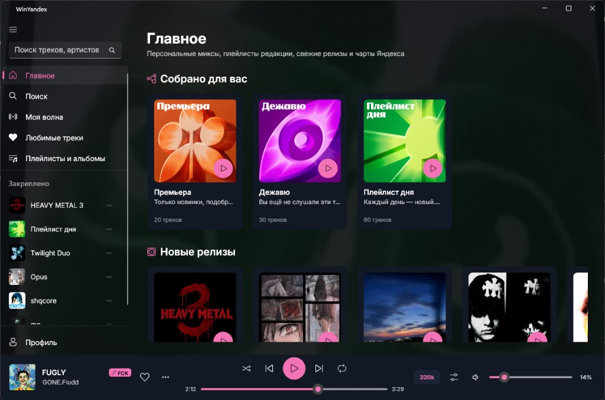

<h1 align="center">WinYandex Themes</h1>

<p align="center">
  <strong>Каталог пользовательских тем оформления для WinYandex</strong>
</p>

<p align="center">
  <a href="README.md">English</a> • <strong>Русский</strong>
</p>

<p align="center">
  <a href="https://github.com/pixiemays/WinYandex"></a>
  <a href="https://github.com/pixiemays/winyandex-themes"></a>
  <a href="https://github.com/pixiemays/WinYandex/blob/main/LICENSE"></a>
</p>

---

Репозиторий тем оформления и каталог для встроенной витрины сообщества в клиенте **[WinYandex](https://github.com/pixiemays/WinYandex)**.

---

## Каталог

### Mega Meow



* **Автор:** [@pixiemays](https://github.com/pixiemays)
* **Акцентный цвет:** `#FFF472B6`
* **Базовая тема:** Dark
* **Материал подложки:** MicaAlt

**[Скачать пакет темы mega-meow.wytheme](https://github.com/pixiemays/winyandex-themes/raw/main/themes/mega-meow/mega-meow.wytheme)**  
*(после скачивания откройте файл или перетащите его в окно WinYandex)*

---

## Способы установки

### 1. Из интерфейса приложения
1. Откройте **WinYandex** -> перейдите в **Профиль / Настройки** -> раздел **Внешний вид**.
2. В карточке **Темы сообщества** нажмите **«Развернуть ∨»**.
3. Выберите нужную тему и нажмите **«Установить»** / **«Применить»**.

### 2. В один клик по ссылке
Нажмите ссылку `winyandex://theme/install?url=...` в браузере или README. Клиент автоматически скачает тему, распакует её и применит с уведомлением в плеере.

### 3. Перетаскиванием (Drag & Drop)
Скачайте архив `.wytheme` или файл `.json` и перетащите его мышью в любое место окна WinYandex.

---

## Спецификация формата темы

Темы распространяются в виде архивов `.wytheme` (ZIP) или отдельных файлов `.json`.

### Конфигурация (`theme.json`)

```json
{
  "id": "theme-identifier",
  "name": "Theme Name",
  "author": "Author Name",
  "version": "1.0",
  "description": "Краткое описание темы",
  "baseTheme": "Dark",
  "backdrop": "MicaAlt",
  "accentColor": "#FFF472B6",
  "backgroundColor": "#FF0B0E14",
  "cardColor": "#FF131924",
  "secondaryCardColor": "#FF1A2332",
  "backgroundImage": "background.jpg",
  "backgroundOpacity": 0.3
}
```

### Параметры

| Поле | Тип | Описание |
|---|---|---|
| `id` | String | Уникальный идентификатор темы в kebab-case (латиница). |
| `name` | String | Отображаемое название темы. |
| `author` | String | Имя или никнейм автора. |
| `version` | String | Номер версии темы. |
| `description` | String | Краткое описание темы в карточке. |
| `baseTheme` | String | Базовая палитра WinUI: `"Dark"` или `"Light"`. |
| `backdrop` | String | Системный материал подложки Windows: `"Mica"`, `"MicaAlt"`, `"Acrylic"` или `"Solid"`. |
| `accentColor` | Hex String | Акцентный цвет (`#AARRGGBB` или `#RRGGBB`) для кнопок, ползунков и активных элементов. |
| `backgroundColor` | Hex String | Тинт подложки окна. |
| `cardColor` | Hex String | Цвет основных карточек контента. |
| `secondaryCardColor` | Hex String | Цвет вторичных панелей и списков. |
| `backgroundImage` | String | Относительное имя файла обоев в архиве (например, `background.jpg`). |
| `backgroundOpacity` | Number | Прозрачность адаптивного затемнения фона (от `0.05` до `0.90`). |

---

## Добавление тем в каталог

1. Сделайте Fork этого репозитория.
2. В папке `themes/<theme-id>/` разместите:
   * `theme.json`
   * `preview.jpg` — скриншот запущенного приложения с применённой темой.
   * `<theme-id>.wytheme` — архив темы, экспортированный через WinYandex.
3. Добавьте запись о теме в `community_themes.json`:
   ```json
   {
     "id": "theme-id",
     "name": "Theme Name",
     "author": "YourHandle",
     "version": "1.0",
     "description": "Описание темы",
     "accentColor": "#FF...",
     "previewUrl": "https://raw.githubusercontent.com/pixiemays/winyandex-themes/main/themes/theme-id/preview.jpg",
     "downloadUrl": "https://raw.githubusercontent.com/pixiemays/winyandex-themes/main/themes/theme-id/theme-id.wytheme"
   }
   ```
4. Откройте Pull Request.

---

## Лицензия

Распространяется под лицензией [GNU General Public License v3.0](https://github.com/pixiemays/WinYandex/blob/main/LICENSE).
